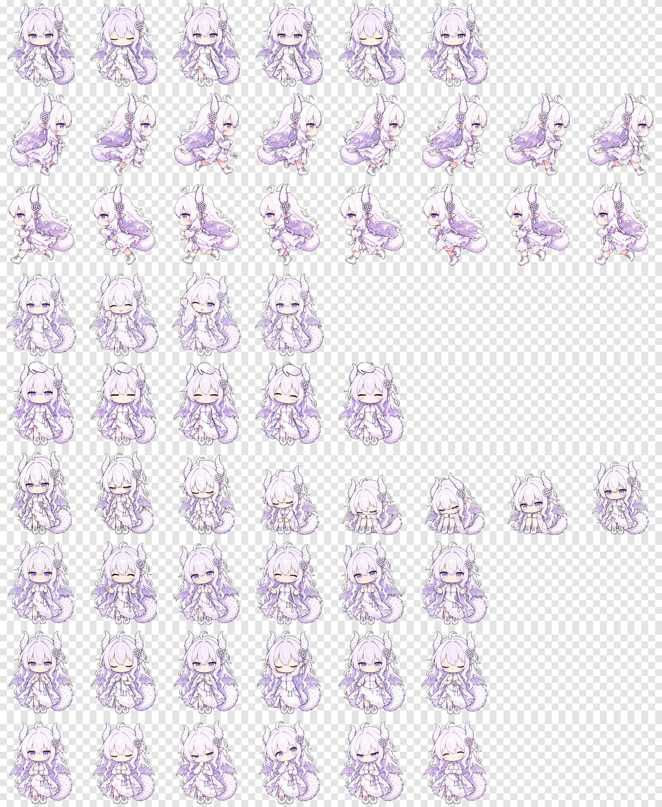

# 珑珑 · Codex Desktop Pet

一只白紫色 Q 版龙娘 Codex 桌宠，包含待机、左右移动、挥手、摸头、失败、等待、工作和审阅等动画。

> 本项目是非官方同人作品，与 OpenAI 无隶属或背书关系。角色设计基于网络流传的参考形象制作；原始形象相关权利归其原作者或权利人所有。本仓库暂不授予素材再分发、商用或二次授权许可。如你是权利人并希望调整或移除内容，请提交 Issue。



## 文件结构

```text
longlong-codex-pet/
├─ longlong/
│  ├─ pet.json
│  └─ spritesheet.webp
└─ assets/
   ├─ preview.png
   └─ headpat.gif
```

Codex 实际读取的是 `longlong/` 文件夹。`pet.json` 和 `spritesheet.webp` 必须直接位于该文件夹内，不能再多套一层目录。

## Windows 安装

将仓库中的 `longlong` 文件夹复制到：

```text
%USERPROFILE%\.codex\pets\longlong
```

PowerShell 示例（在仓库根目录运行）：

```powershell
$destination = Join-Path $env:USERPROFILE '.codex\pets\longlong'
New-Item -ItemType Directory -Force -Path $destination | Out-Null
Copy-Item -Path '.\longlong\*' -Destination $destination -Force
```

安装完成后应为：

```text
C:\Users\<你的用户名>\.codex\pets\longlong\pet.json
C:\Users\<你的用户名>\.codex\pets\longlong\spritesheet.webp
```

## macOS / Linux 安装

在仓库根目录运行：

```bash
mkdir -p "$HOME/.codex/pets/longlong"
cp longlong/pet.json longlong/spritesheet.webp "$HOME/.codex/pets/longlong/"
```

如果设置了 `CODEX_HOME`，请改用：

```bash
mkdir -p "$CODEX_HOME/pets/longlong"
cp longlong/pet.json longlong/spritesheet.webp "$CODEX_HOME/pets/longlong/"
```

## 在 Codex 中启用

1. 安装上述两个文件。
2. 打开 Codex 设置中的外观／桌宠选项。
3. 刷新桌宠列表或重启 Codex。
4. 选择“珑珑”。

若仍显示旧动画，请先切换到其他桌宠，再切回“珑珑”，或完全重启 Codex 以清除图集缓存。

## 卸载

Windows PowerShell：

```powershell
Remove-Item -LiteralPath (Join-Path $env:USERPROFILE '.codex\pets\longlong') -Recurse
```

macOS / Linux：

```bash
rm -rf "$HOME/.codex/pets/longlong"
```

## 技术规格

- 图集：透明 WebP
- 图集尺寸：`1536 × 1872`
- 单帧尺寸：`192 × 208`
- 布局：8 列 × 9 行
- 动画状态：idle、running-right、running-left、waving、jumping（已替换为摸头）、failed、waiting、running、review

## 说明

- 本仓库不包含制作时使用的原始参考图。
- 请勿将本项目描述为 OpenAI 官方角色或官方桌宠。
- 公开再发布前，请自行确认对参考形象及衍生素材拥有必要权利。
